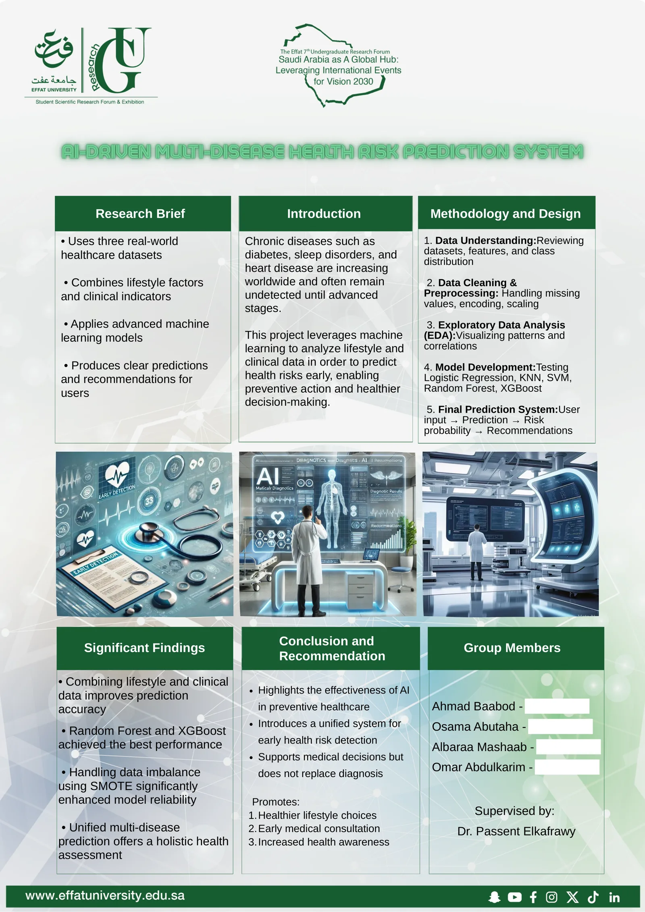
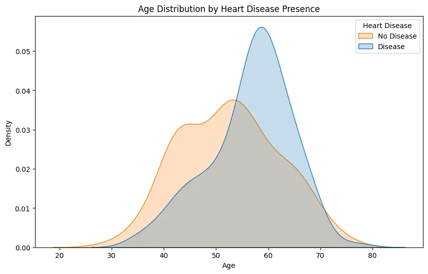
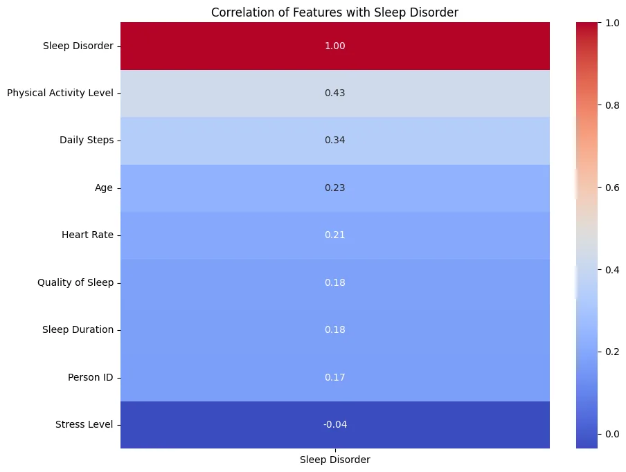
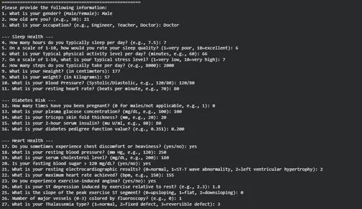
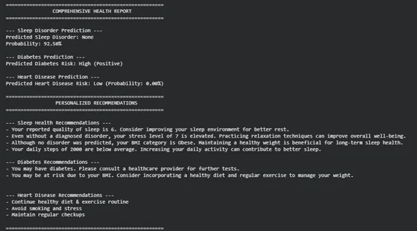

# Multi-Disease Health Risk Prediction

Machine-learning models that estimate the risk of **sleep disorders**, **diabetes** and **heart disease** from lifestyle and clinical data, combined into one personalised health report.

Built for the Data Science course at Effat University (Fall 2025), then extended into a research paper and poster presented at Effat's **7th Undergraduate Research Forum (UGRF 2026)**.

> 📄 Case study: [osvr7.github.io/project.html?p=health-risk](https://osvr7.github.io/project.html?p=health-risk)



## Overview

Chronic conditions such as diabetes, sleep disorders and heart disease often go unnoticed until they are advanced, and most prediction tools look at one condition at a time. This project trains a separate classifier for each condition on a public dataset. It then asks the user one short questionnaire and returns a combined report with a risk probability and recommendations for each condition.

## What the notebook does

1. **Data cleaning:** removes duplicates, encodes categorical columns and scales features. In the diabetes data, physiologically impossible zero values (glucose, blood pressure, skin thickness and more) are treated as missing and replaced with column means.
2. **Exploratory analysis:** correlation heatmaps, histograms, age KDE plots and cholesterol boxplots.
3. **Model comparison:** seven classifiers per condition (Logistic Regression, KNN, SVM, Gaussian Naive Bayes, Decision Tree, Random Forest, Extra Trees), each tuned with 5-fold `GridSearchCV`.
4. **Model selection:** the model with the best held-out test accuracy is kept for each condition.
5. **Health report:** an interactive console questionnaire feeds all three models and prints a combined report with recommendations.

## Results

Best test accuracy per condition, as printed by the notebook (single train/test split):

| Condition | Dataset | Records | Best model | Test accuracy |
|---|---|---|---|---|
| Sleep disorder | Sleep Health and Lifestyle | 374 | SVM (linear) | **90.7%** |
| Heart disease | Heart Disease (UCI) | 303 | Gaussian Naive Bayes | **89.5%** |
| Diabetes | Pima Indians Diabetes | 768 | Random Forest | **73.8%** |

<p>
  
  
</p>

## Example output

| Questionnaire | Generated report |
|---|---|
|  |  |

## Paper and posters

| Document | Description |
|---|---|
| [`docs/Final Paper.pdf`](docs/Final%20Paper.pdf) | IEEE-format research paper |
| [`docs/UGRF-2026-poster.pdf`](docs/UGRF-2026-poster.pdf) | UGRF 2026 poster |
| [`docs/data-science-poster.pdf`](docs/data-science-poster.pdf) | Data Science course poster |

> The paper also reports the team's extended experiments (including XGBoost and SMOTE), which are not part of this notebook. The results table above is what `health_risk_prediction.ipynb` reproduces.

## Run it

```bash
pip install -r requirements.txt
jupyter notebook health_risk_prediction.ipynb
```

Run the cells top to bottom. The last section asks for your inputs and prints the report.
The datasets are in `data/`.

## Project structure

```text
health_risk_prediction.ipynb   Cleaning, EDA, model training and the final report
data/                          The three public datasets (CSV)
docs/                          Research paper and posters (PDF)
assets/screenshots/            Figures used in this README
```

## Tech

Python · pandas · scikit-learn · seaborn · Matplotlib · Jupyter

## Team

| Member | Focus |
|---|---|
| **Osama Abutaha** | Heart-disease model: cleaning, encoding and scaling, exploratory visualisations, comparison of all classifiers |
| Ahmad Baabod | Sleep-disorder model and final prediction system |
| Albaraa Mashaab | Diabetes data quality and model training |
| Omar Abdulkarim | Diabetes preprocessing, validation and probability scoring |

Supervised by **Dr. Passent Elkafrawy**, Effat University.

## Data sources

- Sleep Health and Lifestyle Dataset (Kaggle)
- Pima Indians Diabetes Database (National Institute of Diabetes and Digestive and Kidney Diseases, via Kaggle)
- Heart Disease Dataset (UCI Machine Learning Repository)

## Disclaimer

This is an academic project. Its predictions are a decision-support demonstration and are **not** a medical diagnosis.
